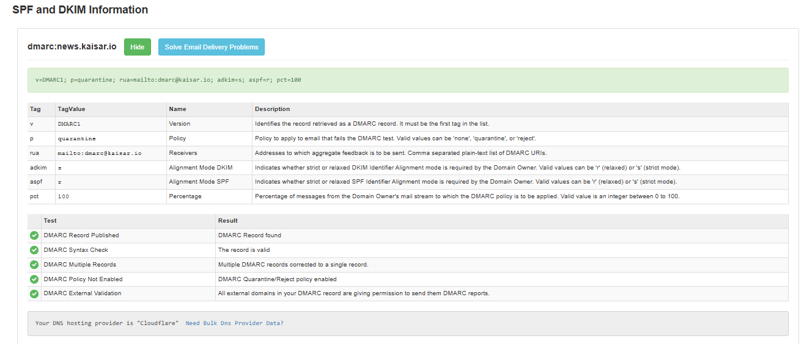

# Email Security Analysis and Windows Installer Triage

## Project Overview

This project documents a hands-on security investigation involving email authenticity checks, email-header analysis, threat-intelligence review and static triage of a Windows installer.

The objective was to assess suspicious-looking email characteristics, examine the authentication evidence, investigate a downloaded executable without running it, and compare findings against the software publisher's published release information.

**Investigation date:** 25 November 2026  
**Analyst:** Clinton Chidera  
**Focus areas:** Email Security, Phishing Analysis, Threat Intelligence, Windows Security and Malware Triage

## 1. Email Security Analysis

### Case A: Kaisar Legacy Rewards Email

**Subject:** Your legacy rewards are ready in Kaisar  
**Sender:** `hello@news.kaisar.io`  
**Reply-To:** `support@kaisar.io`

The email informed previous ZeroNode and Kaisar Provider users that their legacy rewards could be accessed through the Kaisar application. It instructed recipients to sign in with the same Google account used by their ZeroNode account or to create a new account.

#### Header Authentication Findings

| Check | Result | Interpretation |
|---|---|---|
| SPF | Pass | Sending server was authorised by the envelope sender's domain |
| DKIM | Pass | Message signature verification succeeded |
| DMARC | Pass | Domain alignment and authentication policy checks passed |
| Sending infrastructure | Amazon SES | Email was delivered through Amazon Simple Email Service |
| Sender domain | `news.kaisar.io` | Consistent with the sender domain identified in the message |

The email's authentication results provide positive evidence that it was sent through authorised infrastructure for the authenticated domain.

#### Evidence Images

- 
  **h1:** DKIM public-key and signature review for `amazonses.com`.
- 
  **h2:** DKIM public-key and signature review for `news.kaisar.io`.
- 
  **h3:** SPF record and authentication review for `mail.news.kaisar.io`.
- 
  **h4:** DMARC record and authentication review for `dmarc.news.kaisar.io`.

#### Link Analysis

The visible destination was `https://app.kaisar.io/`. The HTML version used an Amazon SES tracking redirect before forwarding the recipient to the application.

The destination domain is consistent with the official Kaisar application domain. A tracking redirect should still be inspected rather than trusted solely because its final destination looks familiar.

#### Email Assessment

**Assessment: Likely legitimate, based on the available evidence.**

The sender domain, SPF, DKIM and DMARC results, reply-to address and application destination were consistent with the publisher's official domains. This does not independently verify reward balances, token eligibility or the claims made by the service.

### Case B: ALX Africa Community CV Review Email

**Subject:** GET YOUR CV READY FOR YOUR NEXT CAREER MOVE!  
**Displayed sender:** ALX Africa Community  
**Sending address:** `no-reply@notification.circle.so`  
**Reply-To:** `community@sandtech.com`

The message promoted a 45-minute CV review session redeemable for 2,000 Legacy Points.

| Check | Result | Interpretation |
|---|---|---|
| SPF | Pass | Sending infrastructure was authorised |
| DKIM | Pass | The message signature verified |
| DMARC | Pass | Authentication passed for the authenticated sending domain |
| Sending service | Mailgun | The message was sent using Mailgun infrastructure |
| Sending domain | `notification.circle.so` | The authenticated domain was not `alxafrica.com` |
| DMARC policy | `p=none` | The domain's published policy was monitoring rather than quarantine or rejection |

#### Evidence Images

- 
  **h5:** Email authentication evidence associated with the ALX Africa Community CV review message.
- 
  **pass:** Authentication pass evidence associated with the email security investigation.

**Assessment: Likely legitimate community communication, but sender identity requires context.**

SPF, DKIM and DMARC authenticate the sending domain and message alignment; they do not independently prove that every displayed brand, offer or link is authorised by ALX.

## 2. Windows Installer Security Investigation

| Attribute | Finding |
|---|---|
| File | `Kaisar.Node_2.1.2_x64-setup.exe` |
| Platform | Windows x64 |
| Version | 2.1.2 |
| File size reported by VirusTotal | Approximately 3.53 MB |
| SHA-256 | `0f930057d68140f374f536becd2818ddf403519a2ae52a2b132e8f02e21f4cdf` |
| Execution status | Not executed |

### VirusTotal Findings

**Detection ratio: 2/63**

- SecureAge: Malicious
- Trapmine: Malicious.high.ml.score

Tags included `peexe`, `obfuscated`, `detect-debug-environment` and `overlay`. These findings warrant further investigation but do not independently establish that the executable is malware. Obfuscation and heuristic detections require context.

### Sigma Rule Matches

Crowdsourced Sigma results included:

1. Sysmon File Executable Creation Detected.
2. Load Of RstrtMgr.DLL By An Uncommon Process.

These are behavioural detection rules, not direct proof of malicious activity. `RstrtMgr.dll` is associated with Windows Restart Manager functionality, commonly used by installers.

## 3. Publisher Verification

The official Kaisar downloads page lists Windows version 2.1.2 with the following SHA-256:

`0f930057d68140f374f536becd2818ddf403519a2ae52a2b132e8f02e21f4cdf`

This matches the hash in the VirusTotal report. The publisher states that this release is not Windows Authenticode code-signed and instead provides a Minisign signature and a public key.

**Official resources:**

- https://kaisar.io/downloads
- https://kaisar.io/docs/node/install
- https://kaisar.io/security

## 4. Safe Verification Procedure

The installer was kept unexecuted during the investigation.

### Calculate SHA-256

```powershell
Get-FileHash "$env:USERPROFILE\Downloads\Kaisar.Node_2.1.2_x64-setup.exe" -Algorithm SHA256
```

### Verify the Minisign Signature

```powershell
minisign -Vm "$env:USERPROFILE\Downloads\Kaisar.Node_2.1.2_x64-setup.exe" -P "RWQZTGW5zf2SxIa2AoOHPrzNxzVB98P7Abqe9ZeSzMMWzZbjH5CUHdig"
```

Expected output: `Signature and comment signature verified`

### Inspect Authenticode Status

```powershell
Get-AuthenticodeSignature "$env:USERPROFILE\Downloads\Kaisar.Node_2.1.2_x64-setup.exe" | Format-List Status,StatusMessage,SignerCertificate
```

### Check Microsoft Defender Status

```powershell
Get-MpComputerStatus | Select-Object AMServiceEnabled,AntivirusEnabled,RealTimeProtectionEnabled,AntivirusSignatureLastUpdated
```

### Run a Custom Defender Scan

```powershell
Start-MpScan -ScanType CustomScan -ScanPath "$env:USERPROFILE\Downloads\Kaisar.Node_2.1.2_x64-setup.exe"
```

**Verification status:** These local checks were planned but not recorded. No successful signature verification or clean Defender result is claimed.

## 5. Key Security Lessons

1. Email display names are not sufficient to establish sender authenticity.
2. SPF, DKIM and DMARC provide useful evidence, but do not prove that an email's claims are true.
3. Links should be inspected, including tracking redirects and final destinations.
4. VirusTotal detection ratios should be interpreted in context.
5. File hashes establish whether a download matches a publisher's published checksum.
6. Digital signature verification provides stronger publisher-integrity evidence than filename or download source alone.
7. An unsigned Authenticode result does not automatically mean a file is malicious when the publisher documents another signing mechanism.
8. Potentially suspicious executables should not be run merely to observe their behaviour.

## 6. Investigation Limitations

- Successful local Minisign verification was not completed.
- A local Defender scan result was not recorded.
- Internal executable code was not statically analysed.
- Dynamic analysis was not performed in an isolated malware-analysis environment.
- Network traffic was not inspected from an executed sample.
- Kaisar's reward and token claims were not independently verified.

The executable was not run during the investigation.

## 7. Conclusion

The email-header evidence provided positive authentication indicators for the Kaisar and ALX community messages, but authentication alone was not treated as proof of every message claim.

The Kaisar installer received two detections from 63 VirusTotal vendors. Its SHA-256 matched the value published on the official downloads page. The publisher documents Minisign as its release-signing mechanism.

The available evidence does not justify declaring the installer either definitively malicious or completely safe. Further signature verification and security scanning remain necessary.

## Disclaimer

This is an independent educational security investigation. It is not an endorsement of the software, a formal malware verdict, or a claim that the publisher's security statements have been independently verified.

No executable was run as part of the documented investigation.

**Author:** Clinton Chidera  
**Focus:** Cybersecurity | Blue Team | Email Security | Threat Intelligence | Security Analysis
