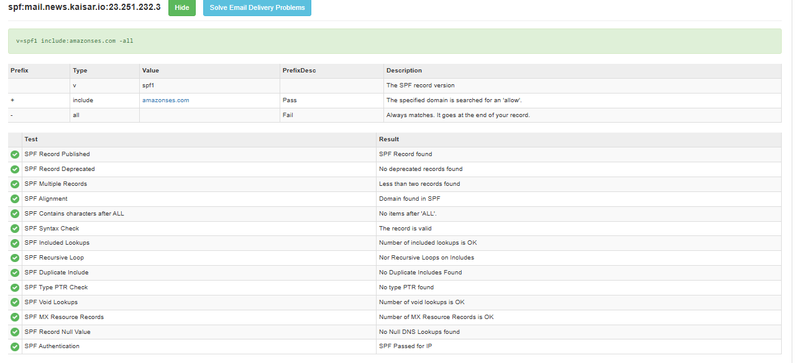
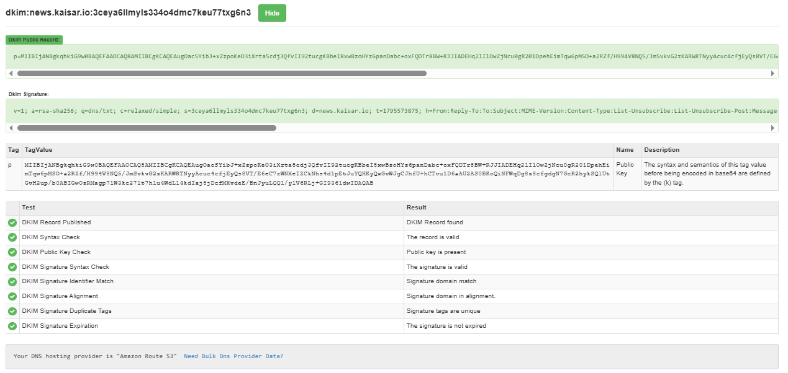
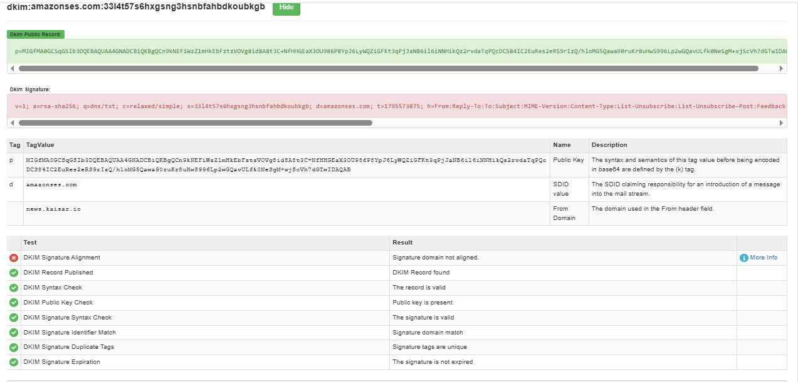
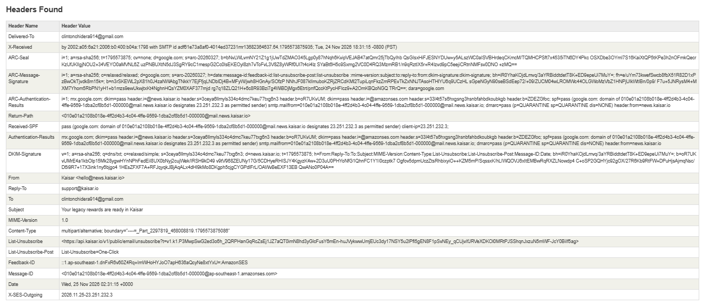
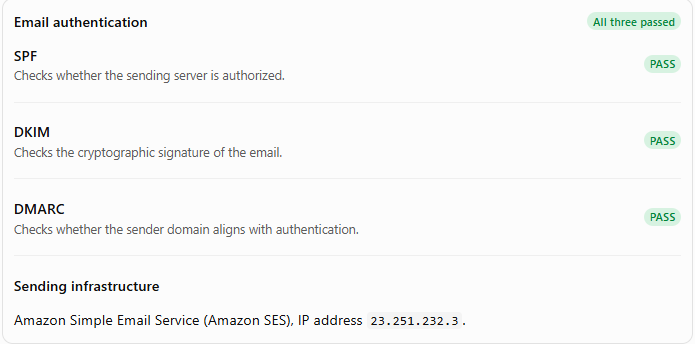

# Email Security Analysis and Windows Installer Triage

**Investigation Type:** Email security and endpoint threat triage  
**Analyst:** Clinton Chidera  
**Investigation Date:** 25 November 2026  
**Role Alignment:** SOC Tier 1 — Email Security, Threat Intelligence and Endpoint Investigation

---

## Executive Summary

This report documents an independent Tier 1 investigation of two potentially suspicious emails and one Windows installer. The investigation assessed email authentication, sender and Reply-To context, tracking and destination URLs, executable reputation, publisher-provided integrity information, and observed static or behavioural indicators.

### Key Findings

| Area | Result | SOC Assessment |
|---|---|---|
| Kaisar Legacy Rewards email | SPF, DKIM and DMARC passed; sender and reply-to domains were aligned with Kaisar infrastructure; the final link resolved to `app.kaisar.io` | **Likely legitimate**, but the reward claims were not independently verified |
| ALX Africa CV review email | SPF, DKIM and DMARC passed for `notification.circle.so`; the sender used Mailgun; DMARC is `p=none` | **Likely legitimate community communication**, but organisational authorisation must be confirmed |
| Kaisar Windows installer | 2 of 63 VirusTotal vendors detected the file; SHA-256 matched the official publisher checksum | **Unconfirmed; controlled validation and escalation recommended** |

### Overall Assessment

The available email evidence supports a likely-legitimate assessment for both messages. Authentication passing does not independently prove that claims, offers or brand use are authorised. The ALX message should therefore receive additional brand-authorisation confirmation, while recipients should avoid entering credentials or sensitive information on an unverified path.

The Kaisar installer is not confirmed malicious or safe based on the available evidence. Although the hash matches the Kaisar-published checksum, two antivirus engines produced detections and the file showed obfuscation and overlay characteristics. The investigation did not execute the file or complete local Minisign and Microsoft Defender verification.

### Risk and Priority

- **Email risk:** Low to moderate pending campaign authorisation and user interaction review.
- **Endpoint risk:** Moderate pending Minisign verification, Defender scanning and isolated sandbox analysis.
- **Priority:** Quarantine or block the installer according to organisational policy, search for the same hash and filename across managed endpoints, and escalate to Tier 2 or Incident Response if execution or malicious sandbox findings are confirmed.

No executable was run during this investigation.

---

## 1. Scope and Objectives

### Scope

- Review of the Kaisar Legacy Rewards email
- Review of the ALX Africa Community CV Review email
- Static triage of `Kaisar.Node_2.1.2_x64-setup.exe`
- Comparison of the installer hash with the publisher's published checksum
- Review of public VirusTotal and Sigma context

### Objectives

1. Determine whether the messages demonstrate legitimate email authentication.
2. Identify misleading display names, forwarding infrastructure or untrusted destinations.
3. Assess the reputation of the downloaded executable without executing it.
4. Verify whether the file matches an officially published publisher hash.
5. Document limitations and a clear escalation path.

### Investigation Constraints

- The executable was not executed.
- Internal executable code was not reverse engineered.
- Local Minisign verification was planned but not completed.
- A local Microsoft Defender scan result was not recorded.
- Dynamic and network analysis were not performed.

---

## 2. Methodology

The investigation used a layered, Tier 1 triage approach:

1. **Email header review** — assessed From/Reply-To fields, sending infrastructure, SPF, DKIM and DMARC.
2. **Link review** — compared visible destinations with HTML destinations and final destinations.
3. **Threat-intelligence review** — examined VirusTotal detections, tags and Sigma matches.
4. **Publisher validation** — compared the sample's SHA-256 with the official Kaisar downloads page.
5. **Safe verification planning** — documented hash, signature and Defender checks that can be performed locally.

### Assessment Principles

- Authentication passing does not prove that every claim or link in an email is authorised.
- A display name does not establish sender identity; the sending and reply-to domains must be reviewed.
- Detection ratios should not be interpreted as a final malware verdict.
- A hash match establishes file identity, not necessarily safe execution behaviour.

---

## 3. Email Security Analysis

### 3.1 Case A — Kaisar Legacy Rewards Email

#### Message Details

| Field | Observed Value |
|---|---|
| Subject | `Your legacy rewards are ready in Kaisar` |
| Sender | `hello@news.kaisar.io` |
| Reply-To | `support@kaisar.io` |
| Claimed purpose | Notification of legacy rewards for previous ZeroNode and Kaisar Provider users |

The message directed recipients to sign in with the same Google account associated with their previous account and directed them to the Kaisar application.

#### Header Authentication Findings

| Check | Result | Interpretation |
|---|---|---|
| SPF | Pass | The sending server was authorised by the relevant domain |
| DKIM | Pass | The cryptographic message signature verified |
| DMARC | Pass | Domain alignment and authentication policy checks passed |
| Sending infrastructure | Amazon SES | The message was delivered through Amazon Simple Email Service |
| Sender domain | `news.kaisar.io` | Consistent with the sender domain identified in the message |

The authentication evidence provides positive support that authorised infrastructure sent the message for the authenticated domain.

#### Authentication Evidence

| Evidence | Finding |
|---|---|
| **h1 — DKIM key and signature** | DKIM public-key and signature review for `amazonses.com`. |
| **h2 — DKIM key and signature** | DKIM public-key and signature review for `news.kaisar.io`. |
| **h3 — SPF record** | SPF authentication review for `mail.news.kaisar.io`. |
| **h4 — DMARC record** | DMARC authentication review for `dmarc.news.kaisar.io`. |

| **h1** | **h2** |
|---|---|
|  |  |

| **h3** | **h4** |
|---|---|
|  |  |

*Figure 1: DKIM, SPF and DMARC evidence for the Kaisar Legacy Rewards email.*

#### Link Analysis

- **Visible destination:** `https://app.kaisar.io/`
- **Observed HTML behaviour:** Used an Amazon SES tracking redirect before forwarding the recipient to the application.
- **Final destination domain:** Consistent with the official Kaisar application domain.

A tracking redirect can hide the underlying path and should be inspected before users interact with it. The redirect being consistent with the official application domain provides additional, but not conclusive, legitimacy evidence.

#### Case Assessment

**Assessment:** Likely legitimate, based on the available evidence.

The sender domain, Reply-To address, authentication results and destination were consistent with Kaisar-controlled domains. The reward balances and token claims were not independently verified.

---

### 3.2 Case B — ALX Africa Community CV Review Email

#### Message Details

| Field | Observed Value |
|---|---|
| Subject | `GET YOUR CV READY FOR YOUR NEXT CAREER MOVE!` |
| Displayed sender | ALX Africa Community |
| Sending address | `no-reply@notification.circle.so` |
| Reply-To | `community@sandtech.com` |
| Claimed purpose | 45-minute CV review session redeemable for 2,000 Legacy Points |

#### Header Authentication Findings

| Check | Result | Interpretation |
|---|---|---|
| SPF | Pass | Sending infrastructure was authorised |
| DKIM | Pass | The message signature verified |
| DMARC | Pass | Authentication passed for the authenticated sending domain |
| Sending service | Mailgun | The message was sent using Mailgun infrastructure |
| Sending domain | `notification.circle.so` | The authenticated domain differs from `alxafrica.com` |
| DMARC policy | `p=none` | The published policy is monitoring rather than quarantine or rejection |

A `p=none` policy means that the domain owner requested monitoring and reporting rather than a policy-based reject or quarantine action. It does not invalidate the authentication pass, but it provides weaker enforcement than `p=quarantine` or `p=reject`.

#### Authentication Evidence

| **h5 — Email Authentication Evidence** | **pass — Authentication Pass Evidence** |
|---|---|
|  |  |

*Figure 2: Authentication evidence for the ALX Africa Community CV review email.*

#### Case Assessment

**Assessment:** Likely legitimate community communication, but sender identity requires organisational context.

SPF, DKIM and DMARC authenticate the sending domain and message alignment. They do not independently prove that every displayed brand, offer or link was authorised by ALX Africa.

**Recommended follow-up:** Confirm brand, marketing or community-platform authorisation through an ALX-controlled source or known internal contact before taking action on sensitive requests.

---

## 4. Indicators of Compromise (IOC) Table

This table contains investigation-specific indicators that are suitable for alerting and enrichment. Values should be triaged in context rather than treated as automatic proof of compromise.

| Indicator Type | Indicator | Context | Recommended Action |
|---|---|---|---|
| Email sender | `hello@news.kaisar.io` | Sender for the Kaisar Legacy Rewards email | Search mail telemetry; allow only if the message and campaign are expected |
| Reply-To | `support@kaisar.io` | Reply-To domain observed in the Kaisar email | Verify against official Kaisar communications |
| Sender domain | `news.kaisar.io` | SPF, DKIM and DMARC authentication evidence | Use as a hunt value, not a sole allow/block condition |
| Email infrastructure | Amazon SES | Delivery infrastructure used by the Kaisar message | Search for the same SES campaign pattern and recipient activity |
| Email sender | `no-reply@notification.circle.so` | ALX Africa community message sender | Search mail telemetry and validate campaign authorisation |
| Reply-To | `community@sandtech.com` | Reply-To observed in the ALX community email | Confirm whether it belongs to an authorised ALX/Sand Tech campaign |
| Sender domain | `notification.circle.so` | Authenticated via Mailgun | Investigate sender identity and brand authorisation |
| Email infrastructure | Mailgun | Delivery infrastructure used by the ALX message | Hunt for matching infrastructure in the mail environment |
| Subject | `Your legacy rewards are ready in Kaisar` | Kaisar campaign subject observed | Search historical and future messages for recipient spread |
| Subject | `GET YOUR CV READY FOR YOUR NEXT CAREER MOVE!` | ALX community campaign subject observed | Search mail logs and correlate with user actions |
| URL domain | `app.kaisar.io` | Final destination associated with the Kaisar email | Verify certificate and inspect login activity |
| SHA-256 | `0f930057d68140f374f536becd2818ddf403519a2ae52a2b132e8f02e21f4cdf` | Kaisar installer 2.1.2 hash | Hunt endpoints, quarantine copies and submit to sandbox |
| Filename | `Kaisar.Node_2.1.2_x64-setup.exe` | Windows installer name | Search endpoint process, file and download telemetry |
| Detection | SecureAge — Malicious | VirusTotal vendor classification | Correlate with endpoint execution and Defender alerts |
| Detection | Trapmine — Malicious.high.ml.score | VirusTotal vendor classification | Correlate with sandbox and behavioural evidence |
| MITRE-related tag | `detect-debug-environment` | Indicates possible anti-analysis behaviour | Prioritize controlled sandbox execution if policy permits |
| MITRE-related tag | `obfuscated` / `overlay` | Packing or integrity characteristics; may be legitimate | Inspect sample structure without user execution |

---

## 5. MITRE ATT&CK Mapping

The following mappings describe investigation-relevant techniques. They are contextual mappings, not confirmation that the observed emails or installer successfully used the techniques.

| Observed or Potential Activity | ATT&CK Technique | ID | Triage Value |
|---|---|---:|---|
| Use of an external community platform or branded display name to support campaign legitimacy | Phishing for Information | T1566.002 (Spearphishing Link) / T1585 (Establish Accounts) when infrastructure appears pre-positioned | Review the destination, reply context and recipient behaviour |
| User requests to sign in or redeem an offer through a link | Phishing: Spearphishing Link | T1566.002 | Hunt for credential-entry, redirects and identity-provider events |
| Tracking redirect used before delivery to the final application | Hidden URL / Redirect | T1566.002 context | Expand, defang and preserve redirect chains in the incident ticket |
| Suspicious Windows executable downloaded or present on an endpoint | Ingress Tool Transfer | T1105 | Search download sources and endpoint file-transfer events |
| Installer executable characteristics and possible evasion | Obfuscated Files or Information | T1027 | Examine packing, strings and overlay data without running the file |
| Debug-environment detection characteristics | Virtualization/Sandbox Evasion | T1497 | Validate in an isolated, monitored environment using appropriate configuration |
| Executable creation or installer-like process behaviour | System Binary Proxy Execution is not confirmed; review as Windows Installer activity | T1218 or application execution context if observed | Correlate process creation and parent-child relationships |
| Restart Manager DLL load may support installer or application behaviour | DLL Side-Loading or indirect loading is not confirmed; require process context | T1574 context | Investigate anomalous process loading `RstrtMgr.dll` |

Use `T1566.002` and credential/account activity for the email cases. Use `T1105`, `T1027` and `T1497` only as hypotheses for the installer until execution or sandbox evidence is available.

---

## 6. Windows Installer Security Investigation

### Sample Details

| Attribute | Finding |
|---|---|
| File name | `Kaisar.Node_2.1.2_x64-setup.exe` |
| Platform | Windows x64 |
| Version | 2.1.2 |
| Approximate size | 3.53 MB |
| SHA-256 | `0f930057d68140f374f536becd2818ddf403519a2ae52a2b132e8f02e21f4cdf` |
| Execution status | Not executed |

### 6.1 VirusTotal Findings

**Detection ratio:** 2/63

| Vendor | Classification |
|---|---|
| SecureAge | Malicious |
| Trapmine | Malicious.high.ml.score |

The remaining 61 vendors did not report a detection in the recorded result.

Observed tags included:

- `peexe`
- `obfuscated`
- `detect-debug-environment`
- `overlay`

These characteristics warrant further investigation but do not independently establish that the executable is malicious. Packagers and installers may use obfuscation or overlay data for legitimate purposes.

### 6.2 Sigma Rule Matches

Crowdsourced Sigma results included:

1. **Sysmon File Executable Creation Detected**
2. **Load Of RstrtMgr.DLL By An Uncommon Process**

These detections are behavioural indicators, not direct proof of malicious activity. `RstrtMgr.dll` is associated with Windows Restart Manager functionality, which installers commonly use.

### 6.3 Risk Interpretation

The available evidence creates a low-to-medium-confidence concern:

- Two engines provided malicious classifications.
- Most engines reported no detection.
- The file uses executable and installer-related characteristics.
- The publisher verification information may explain or reduce, but not eliminate, the concern.

The sample should therefore be **escalated for controlled validation**, not declared definitively malicious or safe.

---

## 7. Publisher and Integrity Verification

The official Kaisar downloads page lists Windows version 2.1.2 with the following SHA-256:

```text
0f930057d68140f374f536becd2818ddf403519a2ae52a2b132e8f02e21f4cdf
```

This value matches the hash in the VirusTotal report. A matching hash establishes that the analysed file is consistent with the publisher's published release identifier.

The publisher states that this release is:

- Not Windows Authenticode code-signed
- Distributed with a Minisign signature
- Associated with a published Minisign public key

**Official resources:**

- https://kaisar.io/downloads
- https://kaisar.io/docs/node/install
- https://kaisar.io/security

An unsigned Authenticode status does not automatically indicate malware when the publisher explicitly documents an alternative signing mechanism. However, it remains important to verify the Minisign signature from the official public key.

---

## 8. Safe Verification Procedure

The commands below are for controlled verification and should be recorded in an investigation ticket.

### 8.1 Calculate SHA-256

```powershell
Get-FileHash "$env:USERPROFILE\Downloads\Kaisar.Node_2.1.2_x64-setup.exe" -Algorithm SHA256
```

Compare the local result exactly against:

```text
0f930057d68140f374f536becd2818ddf403519a2ae52a2b132e8f02e21f4cdf
```

### 8.2 Verify the Minisign Signature

```powershell
minisign -Vm "$env:USERPROFILE\Downloads\Kaisar.Node_2.1.2_x64-setup.exe" -P "RWQZTGW5zf2SxIa2AoOHPrzNxzVB98P7Abqe9ZeSzMMWzZbjH5CUHdig"
```

A successful result may be reported as:

```text
Signature and comment signature verified
```

Record the command output. Do not infer success from the presence of the signature file alone.

### 8.3 Inspect Authenticode Status

```powershell
Get-AuthenticodeSignature "$env:USERPROFILE\Downloads\Kaisar.Node_2.1.2_x64-setup.exe" | Format-List Status,StatusMessage,SignerCertificate
```

### 8.4 Confirm Microsoft Defender Status

```powershell
Get-MpComputerStatus | Select-Object AMServiceEnabled,AntivirusEnabled,RealTimeProtectionEnabled,AntivirusSignatureLastUpdated
```

### 8.5 Run a Custom Defender Scan

```powershell
Start-MpScan -ScanType CustomScan -ScanPath "$env:USERPROFILE\Downloads\Kaisar.Node_2.1.2_x64-setup.exe"
```

**Verification status:** The local checks were planned but not recorded. No successful signature verification or clean Defender result is claimed.

---

## 9. Recommendations

### Immediate Actions

1. Preserve the original `.eml` or `.msg` files and complete email headers.
2. Defang, extract and preserve the URL chain; do not open links from the incident ticket in a normal browser.
3. Search mail, SIEM and endpoint telemetry for both subjects, sender domains, reply-to domains, filename and SHA-256.
4. Block or quarantine the installer through endpoint controls where organisational policy permits, while preserving evidence.
5. Confirm that no affected user executed the installer or entered credentials at either destination.

### Email Containment

- Search for recipient interactions, link clicks and authentication events around the two message timestamps.
- If credential submission is confirmed, reset affected credentials, revoke active sessions and review identity-provider sign-in logs.
- Confirm ALX Africa/Sand Tech authorisation for the CV campaign through an official organisational channel.
- Continue delivery of the Kaisar email unless additional evidence, user reports or campaign anomalies indicate that it is fraudulent.

### Endpoint Validation

- Verify the SHA-256 exactly against `0f930057d68140f374f536becd2818ddf403519a2ae52a2b132e8f02e21f4cdf`.
- Confirm the Minisign signature using the publisher's official public key.
- Record Microsoft Defender, Application Control and endpoint protection scan results.
- Submit the file to an approved isolated sandbox and review process, file, registry, persistence and network behaviour.
- If execution occurred, review process trees, downloaded payloads, persistence mechanisms and network connections; escalate to Tier 2 or Incident Response.

### Long-Term Controls

- Tune email detections for display-name mismatches and third-party sending platforms.
- Strengthen DMARC enforcement to `p=quarantine` or `p=reject` where safely deployed.
- Implement application or file reputation controls for unsigned executables.
- Centralise hash and URL hunting through SIEM and threat-intelligence platforms.
- Document approved signing, download and verification processes for external software.

---

## 10. Investigation Limitations

- Successful local Minisign verification was not completed.
- A local Microsoft Defender scan result was not recorded.
- Internal executable code was not statically analysed.
- Dynamic analysis was not performed in an isolated malware-analysis environment.
- Network traffic was not inspected from an executed sample.
- Kaisar reward and token claims were not independently verified.
- ALX authorisation for the campaign was not independently confirmed with the organisation.

These limitations prevent a definitive malware verdict or final confirmation of campaign authorisation.

---

## 11. Conclusion

The email authentication evidence provided positive indicators for both investigated messages, but authentication alone was not treated as proof of their claims or brand authorisation.

The Kaisar Legacy Rewards message was assessed as likely legitimate. The ALX Africa community message was also assessed as likely legitimate, with organisational context required for higher confidence.

The Kaisar installer received two detections from 63 VirusTotal vendors. Its SHA-256 matched the value published on the official downloads page, and the publisher documents a Minisign-based release-signing method.

A local signature verification, Defender scan and isolated dynamic analysis remain necessary for a high-confidence endpoint-security decision.

---

## 12. Key Security Lessons

1. Email display names are not sufficient to establish sender authenticity.
2. SPF, DKIM and DMARC provide useful evidence but do not prove that an email's claims are true.
3. Links should be inspected, including tracking redirects and final destinations.
4. VirusTotal detection ratios require contextual interpretation.
5. File hashes establish whether a download matches a published checksum.
6. Digital signature verification provides stronger integrity and publisher evidence than filename or download source alone.
7. Unsigned Authenticode status does not automatically indicate malware when an alternative signing mechanism is documented.
8. Potentially suspicious executables should not be run merely to observe their behaviour.

---

## Disclaimer

This is an independent educational security investigation. It is not an endorsement of the software, a formal malware verdict or a claim that the publisher's security statements have been independently validated.

No executable was run as part of the documented investigation.

**Author:** Clinton Chidera  
**Focus:** Cybersecurity | Blue Team | Email Security | Threat Intelligence | Security Analysis
