# Email Security Investigation: GoPhish, Gmail SMTP and Spam Classification

**Author:** Clinton Chidera  
**Category:** Email Security Analysis | SOC Analyst Tier 1  
**Investigation date:** 27 November 2026  
**Environment:** Authorized personal lab — Kali Linux, GoPhish and Gmail  
**Status:** Closed; spam classification cause undetermined  
**Classification:** Training / portfolio report. Account identifiers and unique tracking values should be redacted before public distribution.

---

## Executive Summary

An authorized email-security exercise tested a GoPhish awareness-simulation message sent through Gmail SMTP to a mailbox controlled by the investigator. Gmail's “Show Original” results showed SPF, DKIM and DMARC passing. The simulated email was delivered to Spam. A separate, manually composed message from the same sender to the same recipient also landed in Spam and passed the same authentication checks.

The comparison does **not** establish GoPhish as the cause. The available evidence confirms SMTP submission and successful authentication, but does not identify Gmail's classification rationale. No evidence of account compromise or malicious activity was reported in this exercise. Treat the Spam placement as a deliverability observation, not an indicator of compromise.

**Disposition:** Informational / low-risk, authorized lab activity. Investigation closed with the classification cause undetermined; further provider-side evidence would be required to determine it.

## 1. Triage

| Triage field | Assessment |
|---|---|
| Alert / event | Authorized GoPhish email simulation classified as Spam by Gmail |
| Scope | Two Gmail accounts controlled by the investigator; personal lab |
| Initial severity | Informational (lab exercise; no unauthorized recipient reported) |
| Observed impact | Messages reached the recipient mailbox's Spam folder; no account or endpoint impact reported |
| Authentication | SPF: PASS; DKIM: PASS; DMARC: PASS, as recorded in Gmail Show Original |
| Suspicious artifacts | GoPhish `X-Mailer` header and email-open tracking element; expected in this simulation |
| Compromise assessment | No evidence of compromise identified in the evidence supplied for this report; endpoint telemetry was not assessed |
| Triage decision | No incident escalation indicated by the available evidence. Preserve the headers/screenshots and avoid drawing a cause from Spam placement alone. |

### Triage actions performed

1. Confirmed the test was conducted in the investigator's personal lab using accounts under their control.
2. Reviewed Gmail Show Original for authentication and routing information.
3. Compared the GoPhish message with a manually composed message sent between the same accounts.
4. Checked recipient-side Gmail filters; no custom or sender-specific filter was identified.
5. Recorded the outcome as unresolved because the available evidence does not expose Gmail's internal spam-classification signals.

## 2. Scope, Objectives and Limitations

The exercise aimed to configure an authorized awareness-simulation email, verify Gmail SMTP submission, review SPF/DKIM/DMARC and message headers, and compare Spam placement against a manually composed message.

Testing was limited to the investigator's own lab and controlled mailboxes. The report relies on the investigator's observations and the supplied header excerpts/screenshots. It does not include raw `.eml` files, full unredacted headers, provider-side spam telemetry, mailbox audit logs, endpoint telemetry, or independent reputation/intelligence lookups. The findings therefore do not determine why Gmail classified either message as Spam.

## 3. Executive Incident Record

| Field | Details |
|---|---|
| Case | GoPhish / Gmail Spam-classification investigation |
| Date | 27 November 2026 |
| System/service | Gmail SMTP and Gmail recipient mailbox |
| Activity | Authorized security-awareness simulation and controlled comparison |
| Result | Both the GoPhish email and the manually composed email were placed in Spam |
| Authentication result | SPF, DKIM and DMARC passed for both messages, per the recorded results |
| Root cause | Undetermined |
| Closure | Closed as an informational lab finding; no evidence provided of compromise or unauthorized activity |

## 4. Lab Environment and Method

| Component | Configuration / use |
|---|---|
| Operating system | Kali Linux |
| Simulation platform | GoPhish |
| SMTP service | Gmail SMTP (`smtp.gmail.com`, port 587) |
| Mailboxes | Investigator-controlled Gmail accounts; identifiers redacted in this public report |
| Analysis | Gmail Show Original / header review; comparison with a manually composed message |

The GoPhish sending profile used Gmail SMTP. The HTML template was titled **“Security Awareness Test – Account Verification”** and identified itself as an authorized exercise, with instructions to report it through the approved channel. A campaign was configured for the investigator's own test mailbox.

## 5. Evidence and Screenshots

The following repository screenshots are attached as relative links. Their filenames are preserved; captions identify the evidence artifact without asserting details that are not independently described in the report.

1. **kll.PNG** — [View screenshot](files/kll.PNG)  
   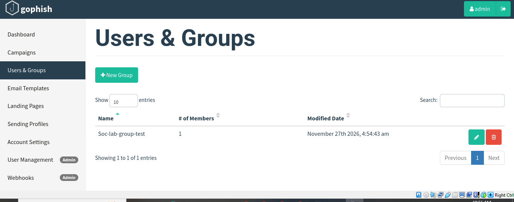
2. **kls.PNG** — [View screenshot](files/kls.PNG)  
   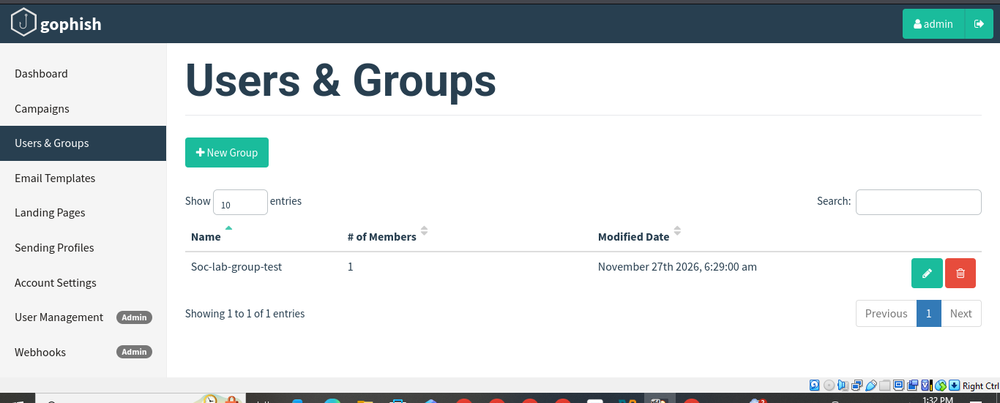
3. **lkk.PNG** — [View screenshot](files/lkk.PNG)  
   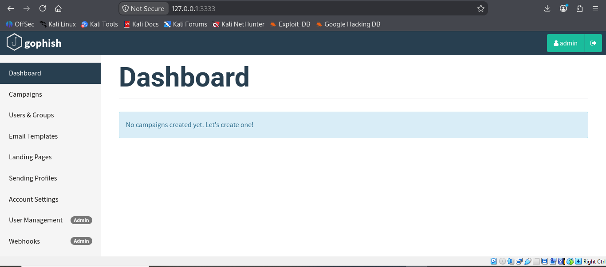
4. **lks.PNG** — [View screenshot](files/lks.PNG)  
   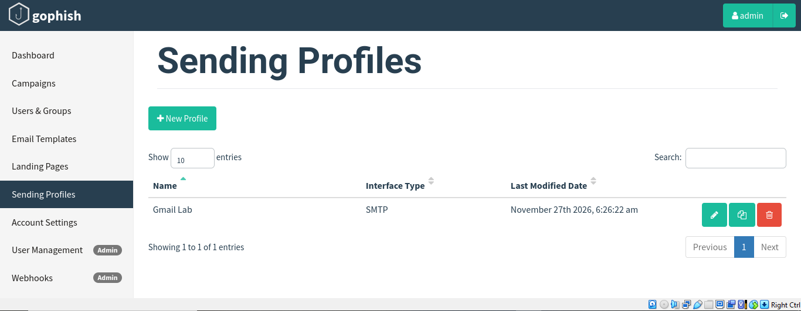
5. **llll.PNG** — [View screenshot](files/llll.PNG)  
   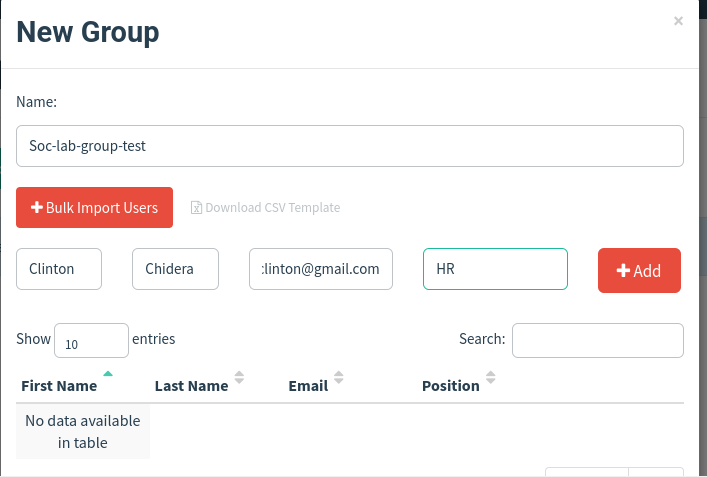
6. **lpl.PNG** — [View screenshot](files/lpl.PNG)  
   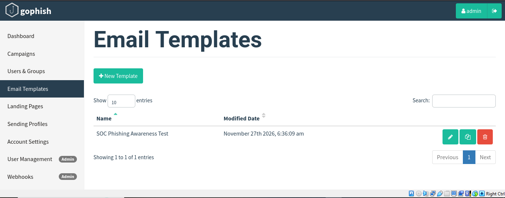
7. **lpn.PNG** — [View screenshot](files/lpn.PNG)  
   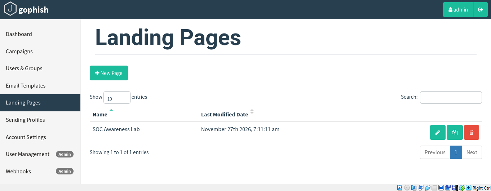
8. **majk.PNG** — [View screenshot](files/majk.PNG)  
   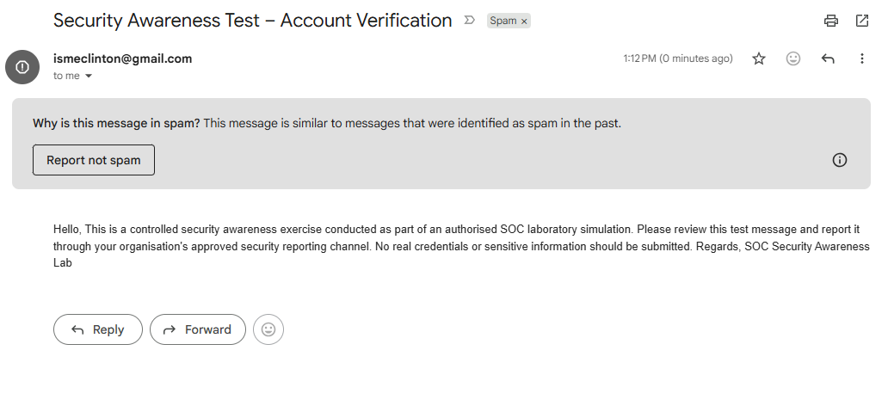
9. **nops.PNG** — [View screenshot](files/nops.PNG)  
   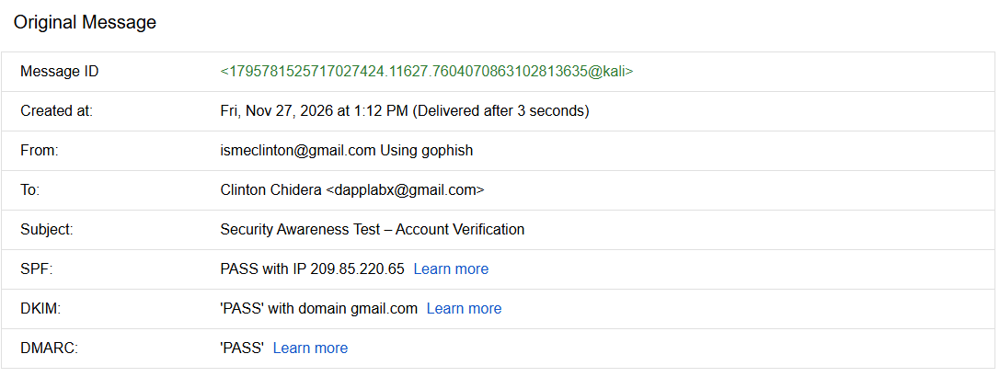
10. **op.PNG** — [View screenshot](files/op.PNG)  
    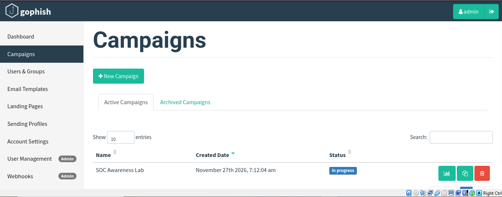
11. **p1.PNG** — [View screenshot](files/p1.PNG)  
    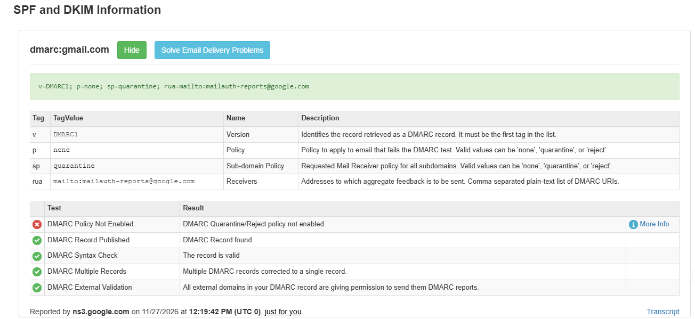
12. **pass.PNG** — [View screenshot](files/pass.PNG)  
    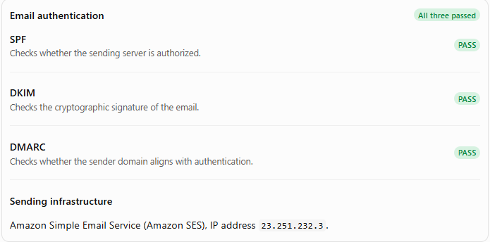
13. **texzt.PNG** — [View screenshot](files/texzt.PNG)  
    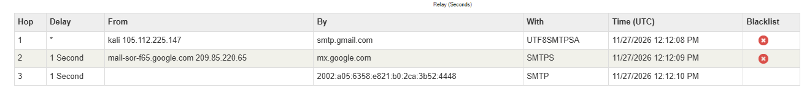
14. **user.PNG** — [View screenshot](files/user.PNG)  
    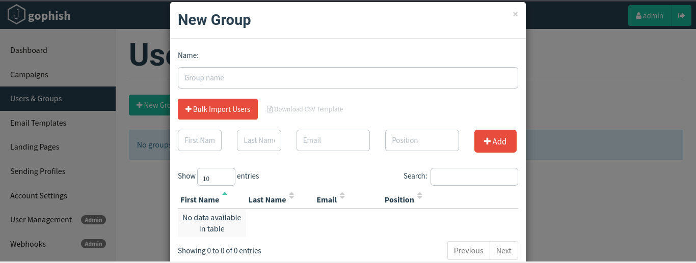

## 6. Technical Findings

### 6.1 Authentication

The recorded Gmail Show Original results were:

| Mechanism | GoPhish message | Manually composed message |
|---|---|---|
| SPF | PASS | PASS |
| DKIM | PASS | PASS |
| DMARC | PASS | PASS |

The inspected output included `spf=pass`, `dkim=pass` and `dmarc=pass`. The recorded DMARC policy text was `dmarc=pass (p=NONE sp=QUARANTINE dis=NONE)`. Authentication passing confirms the reported checks passed; it does not guarantee inbox placement or explain the Spam decision.

### 6.2 Routing and message characteristics

The investigator reported a `Received` header indicating submission from a Kali host to `smtp.gmail.com`, followed by processing through Google's mail infrastructure. A Google mail server address (`209.85.220.65`) was recorded in the comparison. The message included `X-Mailer: gophish` and a hidden image tracking element with a recipient-specific `rid` value. These are consistent with the described GoPhish test; their presence alone does not establish malicious activity.

For privacy, the workstation's public IP, mailbox addresses and unique tracking identifier are intentionally not reproduced here. Preserve the unredacted originals only in an appropriately access-controlled evidence location.

### 6.3 Controlled comparison

| Attribute | GoPhish simulation | Manually composed message |
|---|---|---|
| Sender / recipient | Same controlled accounts | Same controlled accounts |
| Delivery location | Spam | Spam |
| SPF / DKIM / DMARC | PASS / PASS / PASS | PASS / PASS / PASS |
| GoPhish marker | `X-Mailer: gophish` reported | Not present |
| Format | `text/html` reported | `multipart/alternative` reported |

Both messages landing in Spam weakens the hypothesis that GoPhish alone caused the outcome. It does not identify an alternative cause. No conclusion about sender reputation, content scoring, or other Gmail signals can be made from the evidence available.

## 7. Threat Intelligence (TI) Assessment

**Assessment:** No external threat-intelligence enrichment was performed or supplied. The observed artifacts are contextual email and infrastructure observables from an authorized lab, not confirmed malicious indicators.

- The GoPhish marker and tracking element are expected in the documented simulation context.
- `smtp.gmail.com` and the reported Google mail infrastructure address relate to the Gmail delivery path; this report does not classify them as malicious.
- Passing SPF, DKIM and DMARC is an authentication result, not a threat-intelligence verdict.
- Spam-folder placement by itself is not proof of phishing, compromise, or malicious sender reputation.
- No threat actor, malware family, campaign attribution, or malicious infrastructure is established by this investigation.

Any future TI enrichment should be performed against appropriately redacted observables and recorded with the source, timestamp, and confidence. Do not treat shared provider infrastructure as a standalone block indicator.

## 8. IOC and Observable Register

No confirmed malicious IOC was identified. The table below separates investigation observables from actual compromise indicators.

| Observable | Value recorded | Classification / handling |
|---|---|---|
| SMTP host | `smtp.gmail.com` | Gmail service endpoint; contextual, not a malicious IOC |
| SMTP port | `587` | Submission service detail; not an IOC by itself |
| Reported Google mail server IP | `209.85.220.65` | Shared-provider infrastructure in the reported route; not a malicious IOC based on this evidence |
| Workstation public IP | Redacted | Reported in a `Received` header; sensitive lab identifier, retain only in controlled evidence |
| Sender and recipient addresses | Redacted | Investigator-controlled Gmail accounts; personal data, omitted from public report |
| User-Agent / mailer marker | `X-Mailer: gophish` | Application-identification artifact expected for this authorized test; not proof of compromise |
| Tracking path | `/track?rid=[redacted]` | GoPhish-style tracking observable; unique identifier redacted |
| Authentication results | SPF PASS; DKIM PASS; DMARC PASS | Email-authentication findings, not IOCs |
| Message disposition | Spam for both test messages | Delivery outcome; not an IOC or root-cause determination |
| File hashes / attachment IOCs | Not available | No attachment hashes or malicious file indicators were provided |

**IOC conclusion:** The available material supports a record of benign lab observables only. There are no confirmed malicious domains, file hashes, or attacker-controlled IP addresses in the supplied evidence.

## 9. Additional Checks, Findings and Response

The recipient Gmail settings were reviewed; no custom filters or sender-specific filter were identified. This does not exclude other provider-side classification signals or account-level factors.

Key findings:

1. GoPhish successfully submitted the simulation through Gmail SMTP, according to the test record.
2. Gmail's receiving infrastructure accepted and processed the messages.
3. SPF, DKIM and DMARC passed for both compared messages, as recorded.
4. The GoPhish message included a GoPhish-identification header and tracking element.
5. Both the GoPhish and manually composed messages landed in Spam.
6. No custom recipient filter was identified.
7. The cause of Spam classification remains undetermined.
8. No evidence of account compromise or malicious activity was reported; endpoint telemetry was outside the scope of this review.

**Response / disposition:** No containment action was indicated for this controlled test. The case is closed as an informational deliverability investigation. If this behavior affects legitimate operational mail, collect full headers and provider diagnostics, review relevant account/security settings, and use the provider's approved support process.

## 10. Security Lessons Learned

- SPF evaluates whether the sending infrastructure is authorized for the evaluated envelope sender domain.
- DKIM validates a cryptographic signature over selected message content and headers.
- DMARC evaluates alignment and applies the domain's published policy.
- Authentication success does not guarantee inbox placement.
- A Spam disposition does not independently establish maliciousness or compromise.
- Comparative tests can narrow hypotheses, but do not reveal provider-side classifier reasons without additional telemetry.
- Email headers and screenshots are evidence; preserve originals, document collection context, and redact personal or recipient-specific values before public release.

## 11. Conclusion

This authorized lab exercise demonstrated GoPhish configuration, Gmail SMTP submission, header review, and a controlled comparison with a manually composed email. Both messages passed the recorded SPF, DKIM and DMARC checks and both were placed in Spam. Because the manually composed message had the same outcome, the available evidence does not support attributing the result solely to GoPhish. The Spam classification cause remains undetermined.

**Final disposition:** Authorized activity; authentication and SMTP handling verified from the reported evidence; no confirmed malicious IOC; Spam-classification cause undetermined.

**Tools used:** Kali Linux | GoPhish | Gmail SMTP | Gmail Show Original | MXToolbox
