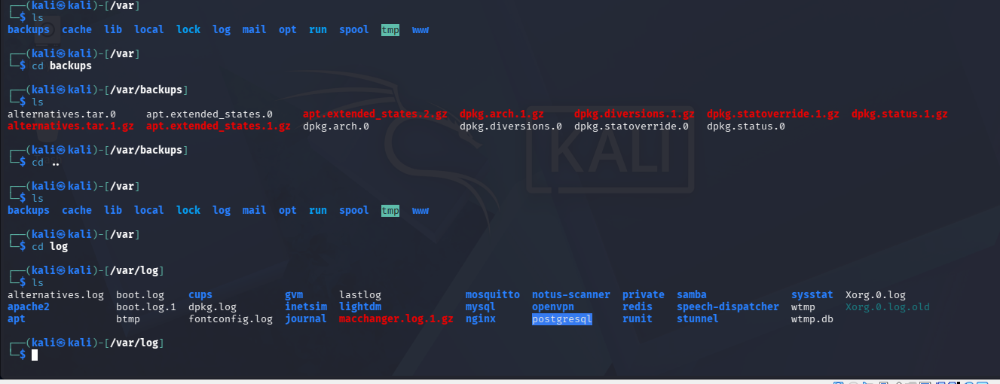
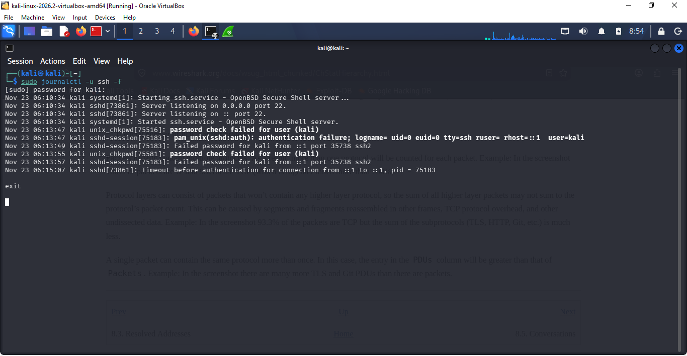
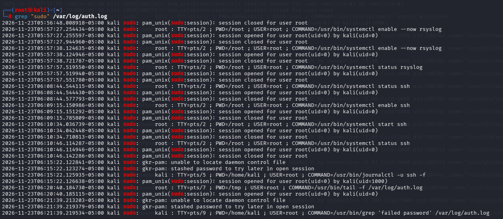
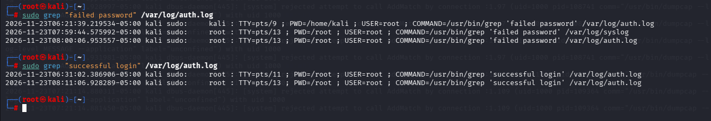
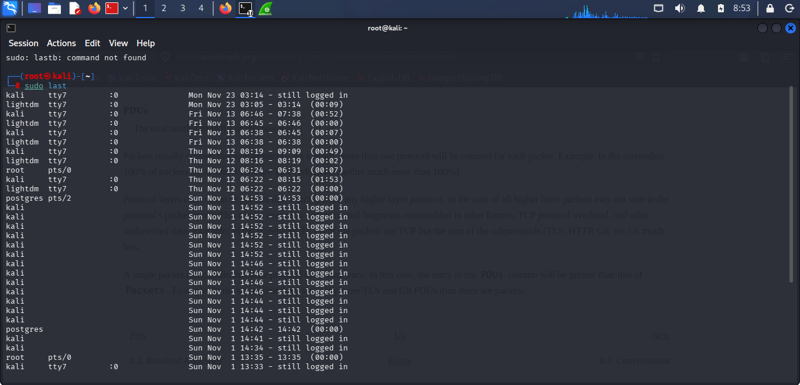

# SOC Analyst L1 Portfolio

**Investigator:** Clinton Chidera  
**Focus:** Security operations, log analysis, incident investigation, and detection engineering  
**Home:** [GitHub Profile](https://github.com/Govamarket)

---

## About This Portfolio

This portfolio documents practical Tier 1 SOC exercises performed in an isolated lab environment. Each investigation follows a structured process: scope the activity, collect evidence, analyse alerts and logs, assess risk, document findings and recommend defensive actions.

The repository is organised as a growing collection of investigations covering Linux and Windows environments, networking, phishing, SIEM monitoring, vulnerability management, threat intelligence and incident response.

> **Environment:** Kali Linux 2026.2 and isolated VirtualBox lab  
> **Classification:** Public lab exercises  
> **Data:** No real-world or production information

---

## Portfolio Structure

| Module | Area | Status | Investigation |
|---|---|---|---|
| 01 | Lab Setup | Complete | [Repository setup and architecture](https://github.com/Govamarket) |
| 02 | Network Analysis | Planned | Protocol and traffic investigation |
| 03 | Windows Investigation | Planned | Windows event and timeline investigation |
| 04 | Linux Investigation | **Complete** | [SSH Authentication Investigation](https://github.com/Govamarket/My-Soc-Analyst-tier-L1-Portfolio-Project/blob/main/Ssh%20authentication%20investigation) |
| 05 | Vulnerability Management | Planned | Vulnerability assessment and register |
| 06 | Threat Intelligence | Planned | IOC investigation and MITRE ATT&CK mapping |
| 07 | SIEM Monitoring | Planned | SIEM setup and alert triage |
| 08 | Phishing Analysis | Planned | Email investigation |
| 09 | Incident Response | Planned | Incident report and lessons learned |
| 10 | Detection Engineering | Planned | Authentication and anomaly rules |
| 11 | Correlation Investigation | Planned | Cross-source alert correlation |
| 12 | SOC Capstone | Planned | Shift report, alert register and incident tickets |

---

## Featured Investigation

### SSH Authentication Monitoring

This investigation examines why Kali Linux did not initially create `/var/log/auth.log`, how journald and rsyslog provide authentication visibility, and how failed SSH attempts appear in the collected evidence.

**Key finding:** the default lab build had no traditional `auth.log`, creating a monitoring blind spot until `rsyslog` was installed and enabled.

[Open the complete SSH authentication report](https://github.com/Govamarket/My-Soc-Analyst-tier-L1-Portfolio-Project/blob/main/Ssh%20authentication%20investigation)

### Evidence

#### 1. Traditional Authentication Logging Was Missing



*Figure 1: The `/var/log` directory contained a `journal` directory but no `auth.log` or `syslog` on the fresh Kali installation.*

#### 2. Failed SSH Attempts Were Recorded in the Journal



*Figure 2: The system journal recorded the SSH service startup, two failed password attempts and a pre-authentication timeout.*

#### 3. rsyslog Restored the Authentication Audit Trail



*Figure 3: `/var/log/auth.log` recorded rsyslog and SSH service changes after logging was enabled.*

#### 4. Detection Searches Require Validation



*Figure 4: A case-sensitive search matched logged administrator commands instead of the SSH authentication failures.*

#### 5. Completed SSH Sessions Were Not Present



*Figure 5: `last` showed local desktop sessions but no successfully completed SSH session at the time of the test.*

---

## Core Analyst Skills Demonstrated

- Linux authentication log investigation
- systemd and journald analysis
- SSH service configuration and monitoring
- Identification of logging blind spots
- Evidence preservation and timeline creation
- Detection search validation
- False-positive and false-assurance analysis
- Mapping findings to security frameworks
- Clear technical documentation for technical and non-technical audiences

---

## Framework Alignment

| Framework | Relevant Controls |
|---|---|
| ISO/IEC 27001:2022 | A.8.15 Logging; A.8.16 Monitoring activities |
| CIS Controls v8 | Control 8: Audit Log Management |
| NIST CSF 2.0 | DE.CM: Continuous Monitoring |
| MITRE ATT&CK | T1021.004 Remote Services: SSH; T1110 Brute Force |

---

## Investigation Workflow

```text
1. Scope the environment and define objectives
2. Verify relevant services and logging sources
3. Generate controlled test activity
4. Preserve screenshots and log evidence
5. Correlate journal, application and account records
6. Build a timeline and identify anomalies
7. Assess business and security impact
8. Recommend detection, hardening and follow-up actions
```

---

## Links

- [GitHub homepage](https://github.com/Govamarket)
- [SSH authentication report](https://github.com/Govamarket/My-Soc-Analyst-tier-L1-Portfolio-Project/blob/main/Ssh%20authentication%20investigation)
- [CTF write-ups](https://github.com/Govamarket/Ctf-writeups)

---

*All activity was performed in an isolated virtual laboratory for learning and documentation purposes.*
