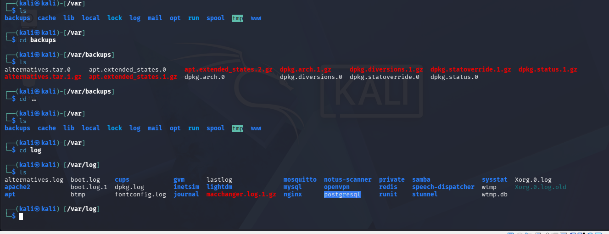
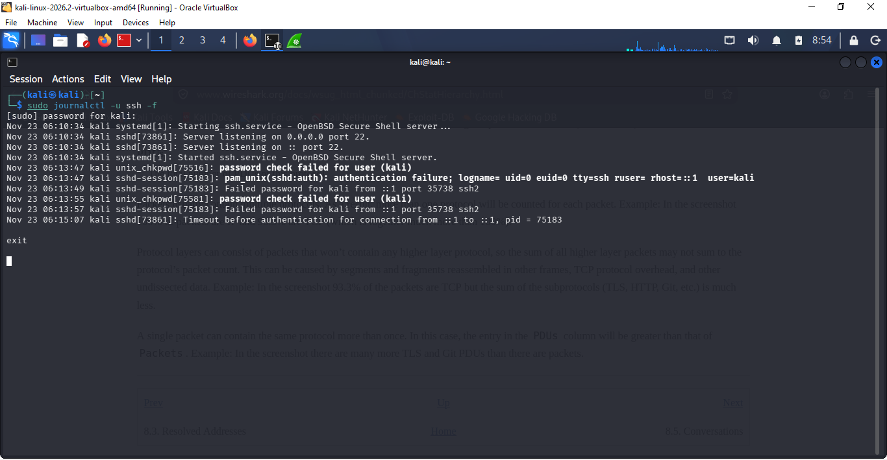
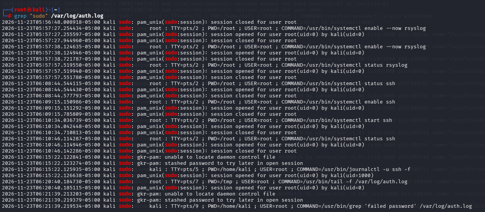
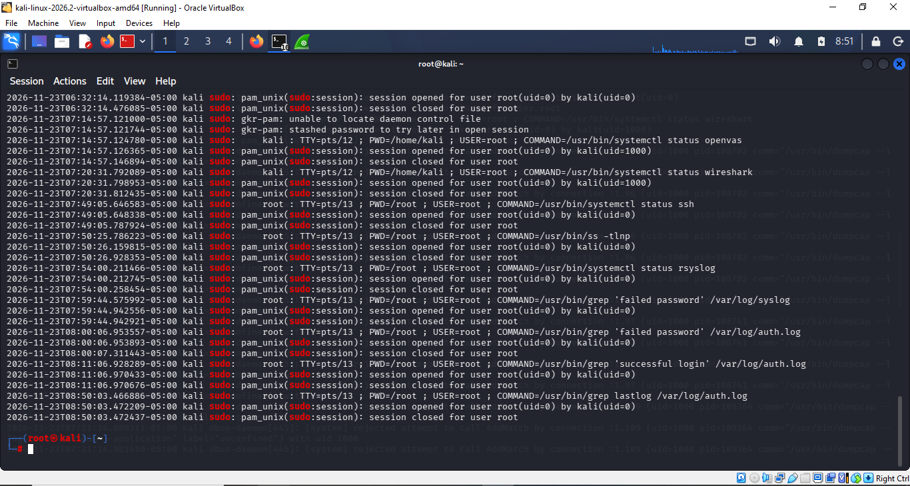
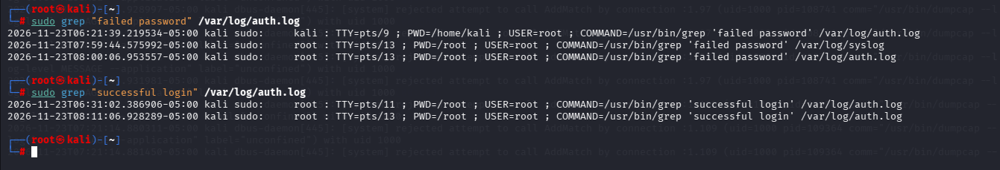
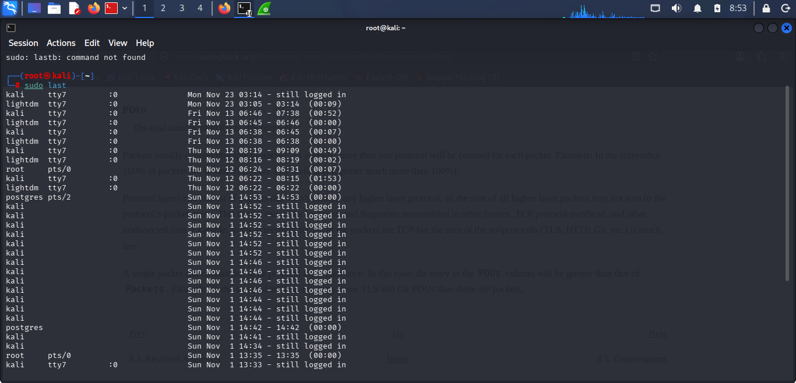

# SSH Authentication Monitoring: Security Investigation Report

**Prepared by:** Clinton Chidera  
**Date:** 23 November 2026  
**Environment:** Kali Linux 2026.2 (isolated VirtualBox lab)  
**Classification:** Public (lab exercise, no production data)

---

## 1. Executive Summary

Remote access services such as SSH are a primary target for attackers, and a business can only defend them if it can see who is trying to log in. This investigation tested whether failed and successful SSH authentication activity could be identified in the system journal and traditional log files. The initial check found no `/var/log/auth.log` or `/var/log/syslog` on the fresh Kali build, because `rsyslog` was not installed. After installing and enabling `rsyslog` and starting SSH, controlled failed-login attempts were recorded and reviewed.

**Key result:** On a default Kali install, SSH authentication events were not written to `/var/log/auth.log` because `rsyslog` was not installed. After installing and enabling `rsyslog`, authentication events were also available in `/var/log/auth.log`.

**Business impact:** A monitoring blind spot for remote access can delay breach detection and increase the cost and scope of an incident.

---

## 2. Scope and Method

| Item | Detail |
|---|---|
| Systems | One Kali Linux VM (local lab only) |
| Log sources | `/var/log/auth.log`, systemd journal, `last` |
| Test scope | SSH service state, failed authentication, login search, audit trail and successful-login procedure |
| Steps | Verified logging, installed and enabled `rsyslog`, enabled and started SSH, generated controlled failed logins, reviewed records |

```bash
sudo apt install rsyslog
sudo systemctl enable --now rsyslog
sudo systemctl enable --now ssh
sudo systemctl start ssh
sudo journalctl -u ssh -f
sudo grep -i "failed password" /var/log/auth.log | grep -v COMMAND
```

---

## 3. Evidence

| Evidence item | Observation |
|---|---|
| SSH service status | Enabled at 06:09:15 and started at 06:10:34 |
| Listening address | `0.0.0.0:22` and `[::]:22` |
| Source IP address | `::1` (IPv6 loopback, the same machine) |
| Target username | `kali` |
| Failed login events | 2, at 06:13:49 and 06:13:57 |
| Session | Same source port (`35738`) and process ID (`75183`) |
| Successful SSH login events | Not captured; procedure is provided in Section 6 |
| Relevant timestamps | System timezone UTC-05:00 |

### Figure 1: Logging gap

The default `/var/log` directory contained a `journal` directory but no `auth.log` or `syslog`.



*Figure 1: On the fresh Kali installation, no traditional authentication log was present.*

### Figure 2: Failed SSH authentication

The journal recorded the SSH service startup, two failed password attempts and a pre-authentication timeout.



*Figure 2: `journalctl -u ssh -f` showing two failed password attempts and the subsequent timeout.*

### Figure 3: Authentication audit trail

After `rsyslog` was enabled, `/var/log/auth.log` recorded privileged service and command activity.



*Figure 3: `auth.log` entries for rsyslog and SSH service changes, including timestamps and the authenticated account.*

A separate audit-trail screenshot also confirms that later administrative commands were written to the log:



*Figure 4: Later `auth.log` entries, including `ss -tlnp` and `grep` commands.*

### Figure 5: Detection pitfall

A case-sensitive search for `failed password` matched only the administrator's own `sudo` command lines rather than the SSH failure events.



*Figure 5: The search returned `sudo` command entries instead of the SSH authentication failures because it used the wrong letter case.*

### Figure 6: No completed SSH session in `last`

The `last` output showed local desktop sessions but no completed SSH sessions.



*Figure 6: `last` showed only local desktop sessions; no successful SSH session had been recorded in `wtmp` at that point.*

---

## 4. Findings and Business Risk

| # | Finding | Risk |
|---|---|---|
| 1 | Default build had no `auth.log`; SSH events existed in the journal | **High.** Tools or analysts relying only on `auth.log` had no visibility |
| 2 | SSH was disabled by default and produced no logs until started | **Low.** A smaller attack surface, but the service must be monitored once enabled |
| 3 | Failed logins were fully recorded after logging was configured | **Positive.** Supports investigation and attribution |
| 4 | Both failures came from one connection and followed an idle timeout | **Informational.** Consistent with a controlled test, not a brute-force campaign |
| 5 | A flawed search returned false assurance | **Medium.** A failed search can hide an active attack |
| 6 | No suspicious activity was identified | **None.** Source was loopback, target was one account and only two attempts occurred |

---

## 5. Recommendations

1. **Standardise logging.** Enable `rsyslog` or forward journald to a central log platform on every system exposing SSH.
2. **Harden SSH.** Set `PermitRootLogin no`, `PasswordAuthentication no`, `MaxAuthTries 3`, and `AllowUsers <named accounts>` where appropriate.
3. **Automate response.** Deploy `fail2ban` or an equivalent control to block sources with repeated failures.
4. **Alert, do not only collect.** Alert on repeated `Failed password` events, logins from new sources and root login attempts.
5. **Validate detections.** Test searches or alerts against known events. Use case-insensitive matching, include `Accepted` events, and exclude self-generated `sudo` entries.
6. **Reduce exposure.** Disable SSH where it is not needed and never expose port 22 directly to the internet.

---

## 6. Completing Successful-Login Evidence

A successful SSH login should produce an `Accepted password` or `Accepted publickey` line. To capture it:

```bash
ssh kali@localhost
sudo grep "Accepted" /var/log/auth.log
sudo journalctl -u ssh | grep "Accepted"
last | grep pts
```

Expected authentication record:

```text
Accepted password for kali from ::1 port <port> ssh2
pam_unix(sshd:session): session opened for user kali(uid=1000)
```

Successful SSH sessions are normally shown by `last` on a `pts/N` terminal.

---

## 7. Alignment with Security Frameworks

| Framework | Relevant control |
|---|---|
| ISO/IEC 27001:2022 | A.8.15 Logging, A.8.16 Monitoring activities |
| CIS Controls v8 | Control 8: Audit Log Management |
| NIST CSF 2.0 | DE.CM: Continuous Monitoring |
| MITRE ATT&CK | T1021.004 Remote Services: SSH; T1110 Brute Force |

---

## 8. Useful Detection Commands

```bash
# Failed logins, case-insensitive, excluding logged sudo command searches
sudo grep -i "failed password" /var/log/auth.log | grep -v COMMAND

# Successful logins
sudo grep "Accepted" /var/log/auth.log

# Same failed-login data from journald
sudo journalctl -u ssh --since today | grep -i "failed"

# Failed-login source addresses
sudo grep -i "failed password" /var/log/auth.log | grep -v COMMAND \
  | grep -oE "from [0-9a-f:.]+" | sort | uniq -c | sort -rn
```

---

## 9. Conclusion

Reliable authentication logging is a baseline control for protecting business systems. This investigation showed that a default build can leave remote access unmonitored, but the visibility gap can be corrected by enabling `rsyslog` or forwarding journald records to a central platform.

---

*All testing was performed on my own isolated virtual machine for learning purposes.*
