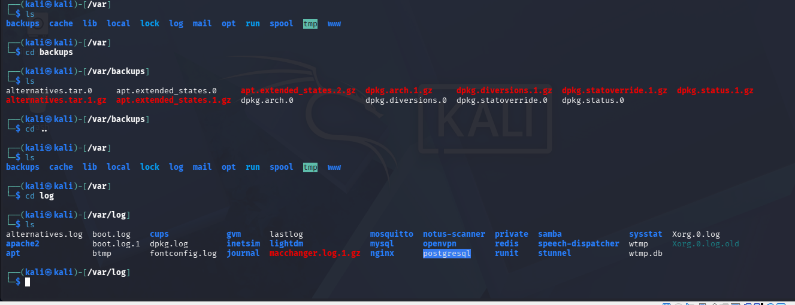
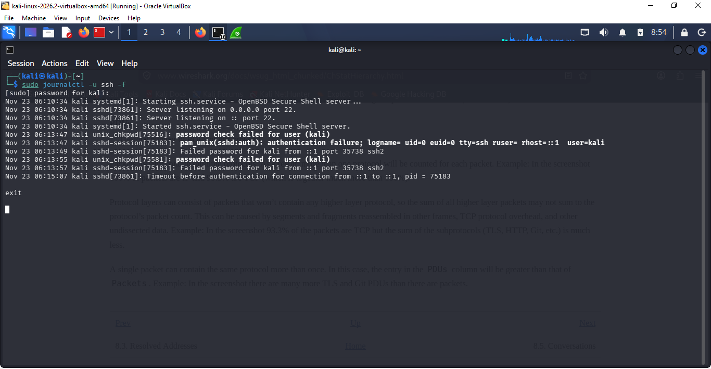
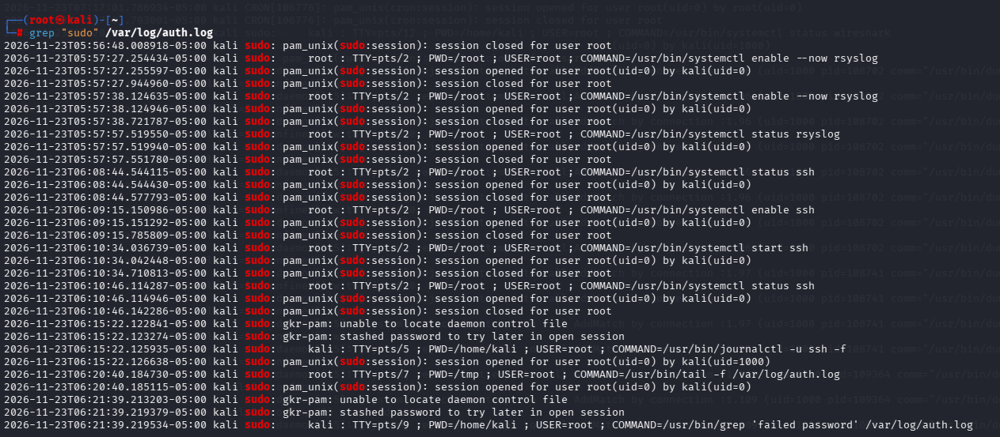
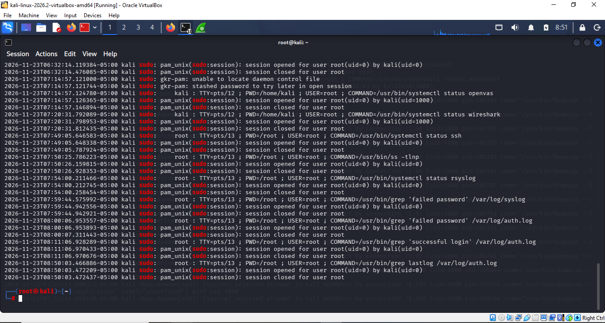
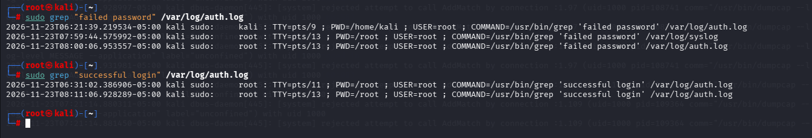
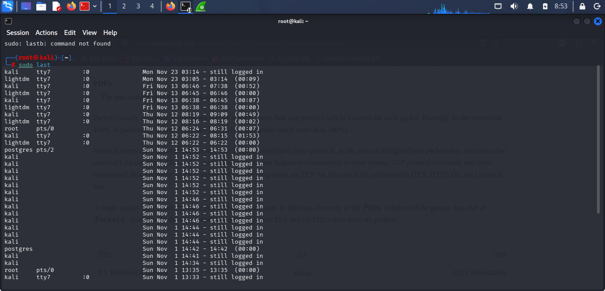

# SSH Authentication Monitoring: Security Investigation Report

**Prepared by:** Clinton Chidera  
**Date:** 23 November 2026  
**Environment:** Kali Linux 2026.2 (isolated VirtualBox lab)  
**Classification:** Public (lab exercise, no production data)

---

## 1. Executive Summary

This investigation tested whether SSH authentication activity on a Kali Linux system could be identified in the system journal and traditional log files. The initial check found no `/var/log/auth.log` because `rsyslog` was not installed. SSH was also not running, so its service journal contained no events. After enabling `rsyslog` and starting SSH, the journal captured two deliberately generated failed password attempts.

**Key result:** Authentication events were visible in `journald` by default. Installing and enabling `rsyslog` also populated `/var/log/auth.log`.

**Assessment:** The two failed attempts originated from `::1` (the local machine), targeted the `kali` account, and were part of the controlled lab test. No suspicious activity was identified. A successful SSH login was not captured in this evidence set.

---

## 2. Scope and Method

| Item | Detail |
|---|---|
| Systems | One Kali Linux VM (isolated VirtualBox lab) |
| Log sources | `/var/log/auth.log`, systemd journal, SSH service journal, `last` / `wtmp` |
| Test scope | Logging configuration, SSH service state, failed authentication, and login records |
| Activity | Enabled `rsyslog` and SSH, generated controlled failed logins, and reviewed the resulting records |
| Time zone | UTC-05:00 |

Commands used included:

```bash
sudo apt update
sudo apt install rsyslog
sudo systemctl enable --now rsyslog
sudo systemctl enable --now ssh
sudo journalctl -u ssh -f
sudo grep -i "failed password" /var/log/auth.log
sudo last
```

---

## 3. Evidence

| Evidence item | Observation |
|---|---|
| SSH service | Enabled at 06:09:15 and started at 06:10:34; listening on `0.0.0.0:22` and `[::]:22` |
| Source address | `::1` (IPv6 loopback; the same machine) |
| Target account | `kali` |
| Failed attempts | Two, at 06:13:49 and 06:13:57 |
| Connection | Both attempts used source port `35738` and process `75183` |
| Successful login | Not captured; steps to collect it are in Section 6 |

### Figure 1: Initial logging configuration

The initial `/var/log` listing contained a `journal` directory but no `auth.log` or `syslog`.



*Figure 1: The fresh Kali installation had journald data but no traditional authentication log.*

### Figure 2: Failed SSH authentication

The SSH journal recorded service startup, two failed password attempts, and a pre-authentication timeout.



*Figure 2: `journalctl -u ssh -f` showing the controlled failed attempts and subsequent timeout.*

### Figure 3: Authentication and service audit trail

After `rsyslog` was enabled, `/var/log/auth.log` recorded privileged service-management commands.



*Figure 3: `auth.log` entries showing rsyslog and SSH service activity.*

A later screenshot shows additional administrative commands recorded in the same log:



*Figure 4: Later `auth.log` entries, including `ss -tlnp` and grep searches.*

### Figure 5: Search self-match

A case-sensitive search for `failed password` did not match sshd's capitalized `Failed password` records. The displayed matches were the `sudo` audit entries for the searches themselves.



*Figure 5: The search matched its own logged command lines, illustrating why searches must be validated against known events.*

### Figure 6: Login session records

`last` showed local desktop sessions and no completed SSH session in `wtmp` at the time of collection. `lastb` was unavailable on this build.



*Figure 6: `last` showed desktop sessions only; no SSH session had been recorded.*

---

## 4. Timeline

| Time (UTC-05:00) | Event |
|---|---|
| 05:57:27 | `rsyslog` enabled and started |
| 06:09:15 | SSH enabled for startup |
| 06:10:34 | SSH started and began listening on port 22 |
| 06:13:47 | First password check failure recorded |
| 06:13:49 | First `Failed password` event for `kali` from `::1` |
| 06:13:55 | Second password check failure recorded |
| 06:13:57 | Second `Failed password` event from the same connection |
| 06:15:07 | Connection timed out before authentication completed |

---

## 5. Findings and Risk

| # | Finding | Assessment |
|---|---|---|
| 1 | `/var/log/auth.log` was absent before `rsyslog` was installed; journal-based logs were available. | **Visibility consideration:** monitoring that relies only on `auth.log` would miss events on this initial configuration. |
| 2 | SSH had not been started initially, explaining the empty SSH service journal. | **Expected:** no SSH service events existed before startup. |
| 3 | The two failed attempts were recorded by PAM and sshd. | **Useful evidence:** records include the account, source address, and event times. |
| 4 | Both failures used the same source port and sshd process. | **Consistent with the lab test:** two attempts occurred within one connection. |
| 5 | The source was loopback and the activity matched the controlled test. | **No suspicious activity identified** in the reviewed evidence. |
| 6 | Searches against `auth.log` were themselves logged through `sudo`. | **Detection pitfall:** validate search results and account for self-generated audit entries. |

### Log search notes

- `grep` is case-sensitive by default; sshd logs `Failed password` with a capital **F**. Use `grep -i` when appropriate.
- Running searches with `sudo` can add command-audit lines to `auth.log`, which may then match later searches. Validate results and exclude command records where needed.
- Successful SSH authentication is logged as `Accepted password` or `Accepted publickey`, not as `successful login`.
- `lastb` was not installed on this system. The journal and `auth.log` were available for reviewing failed attempts.

---

## 6. Completing Successful-Login Evidence

A successful SSH login was not captured for this report. To collect that evidence in the lab, log in with the correct credentials and review the resulting records:

```bash
ssh kali@localhost
sudo grep "Accepted" /var/log/auth.log
sudo journalctl -u ssh | grep "Accepted"
last | grep pts
```

Expected record format:

```text
Accepted password for kali from ::1 port <port> ssh2
pam_unix(sshd:session): session opened for user kali(uid=1000)
```

---

## 7. Recommendations

1. **Standardize log collection.** Ensure authentication events are retained and forwarded to the monitoring platform, whether collected from journald or `rsyslog`.
2. **Harden SSH.** Disable root login, prefer key-based authentication where suitable, and restrict access to named accounts.
3. **Alert on meaningful patterns.** Monitor repeated failures, unexpected source addresses, and successful logins from new locations.
4. **Validate detections.** Test searches and alerts against known events; account for case, command-audit entries, and expected lab activity.
5. **Reduce exposure.** Disable SSH where it is not required and restrict network access to the service.
6. **Complete the evidence set.** Capture and document a successful lab login if needed for the investigation objectives.

---

## 8. Alignment with Security Frameworks

| Framework | Relevant control |
|---|---|
| ISO/IEC 27001:2022 | A.8.15 Logging; A.8.16 Monitoring activities |
| CIS Controls v8 | Control 8: Audit Log Management |
| NIST CSF 2.0 | DE.CM: Continuous Monitoring |
| MITRE ATT&CK | T1021.004 Remote Services: SSH; T1110 Brute Force |

---

## 9. Useful Detection Commands

```bash
# Failed logins; case-insensitive, excluding logged sudo command entries
sudo grep -i "failed password" /var/log/auth.log | grep -v COMMAND

# Successful SSH logins
sudo grep "Accepted" /var/log/auth.log

# Failed SSH events from journald
sudo journalctl -u ssh --since today | grep -i "failed"

# Summarize source addresses in failed-password records
sudo grep -i "failed password" /var/log/auth.log | grep -v COMMAND \
  | grep -oE "from [0-9a-f:.]+" | sort | uniq -c | sort -rn
```

---

## 10. Conclusion

The investigation confirmed that SSH authentication events were available in the system journal, while the traditional `/var/log/auth.log` file appeared after `rsyslog` was installed and enabled. Two controlled failed attempts were recorded from the local machine. The evidence did not show suspicious activity or a completed SSH session.

---

*All testing was performed on my own isolated virtual machine for learning purposes.*
